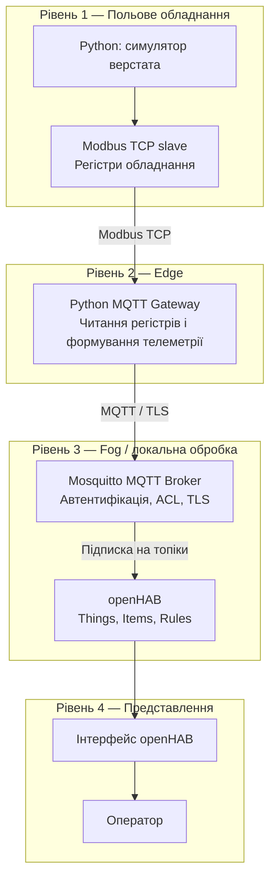
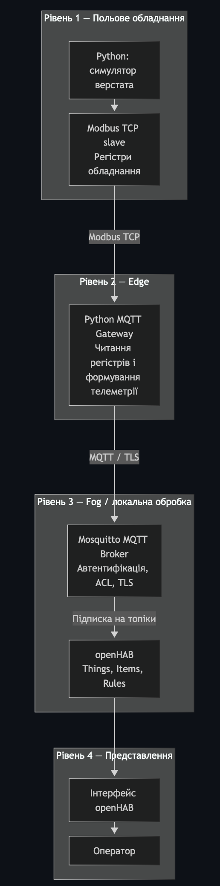
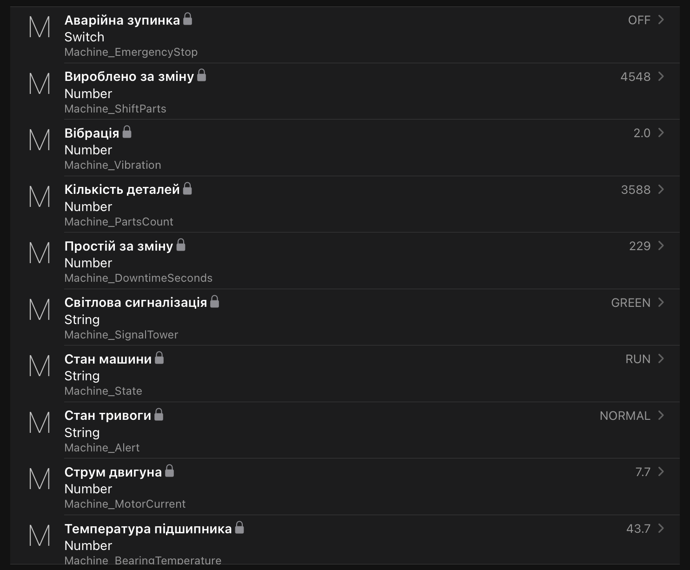
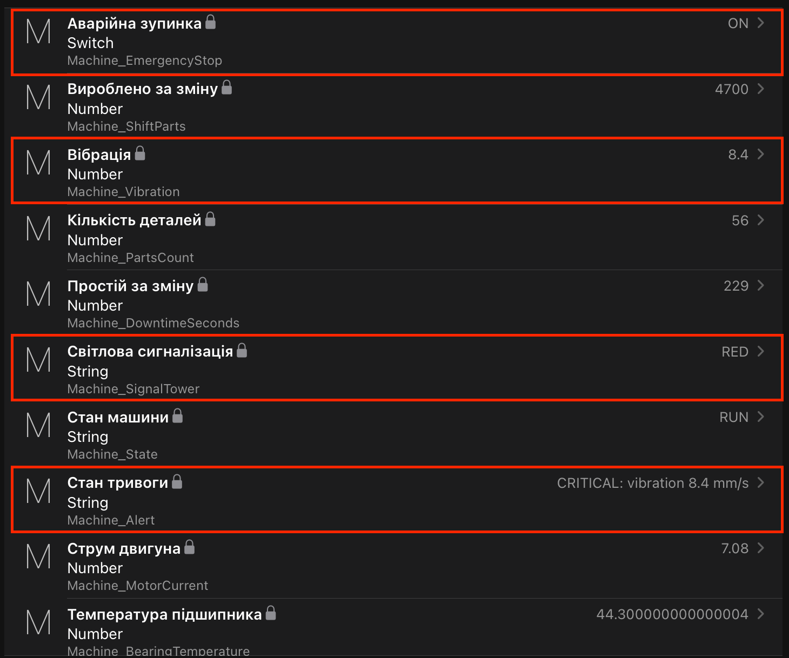
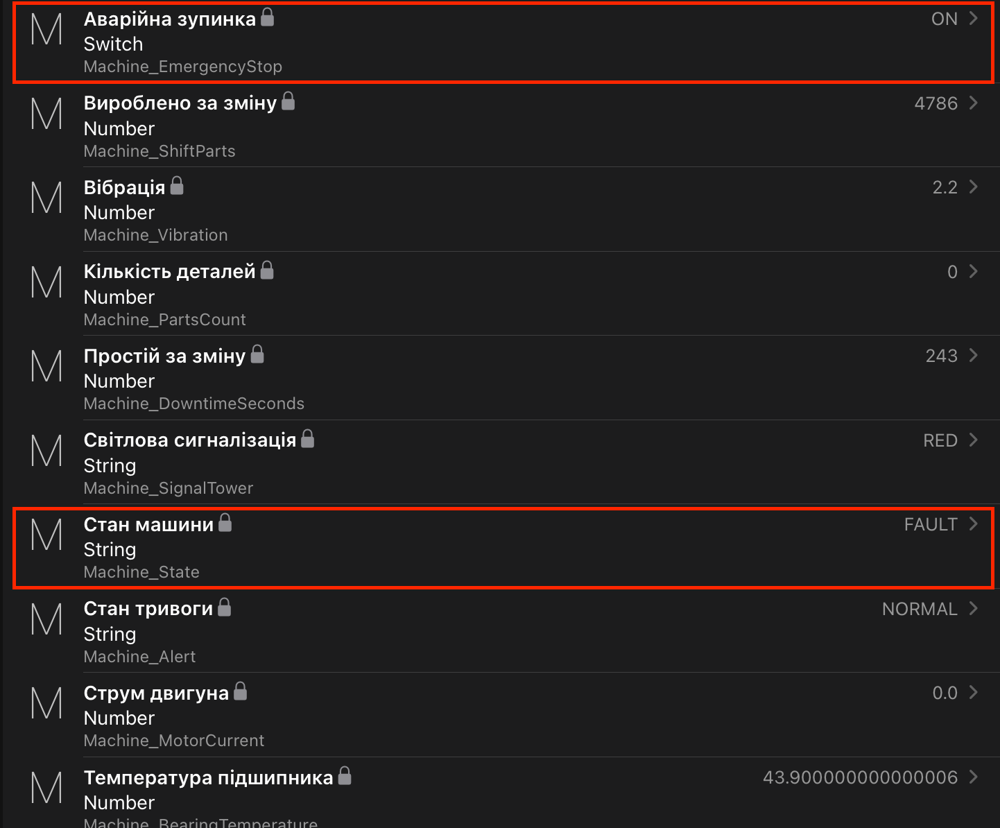
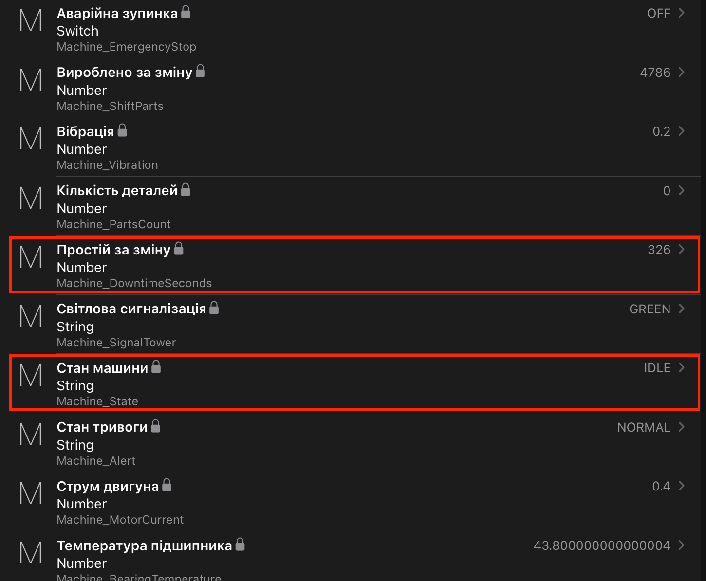

# IIoT-система моніторингу промислового обладнання

> **Відеодемонстрація:** `[Додати посилання на відео]`  
> **Варіант:** 4 — моніторинг промислового обладнання  
> **Проєкт:** `iot-mc1`

## 1. Опис системи

Проєкт реалізує систему Industrial Internet of Things (IIoT) для моніторингу стану промислового верстата. Система моделює роботу обладнання, отримує його параметри через Modbus TCP, передає телеметрію через MQTT-брокер Mosquitto та відображає дані й результати автоматизації в openHAB.

Для демонстрації використано Python-симулятор промислової машини, шлюз Modbus-to-MQTT, захищений MQTT-брокер, конфігурації openHAB та правила обробки телеметрії.

Система дає змогу спостерігати за вібрацією, температурою підшипника, струмом двигуна, кількістю вироблених деталей, станом машини, світловою сигналізацією та аварійною зупинкою. Також реалізовано індикацію тривоги, підрахунок вироблених за зміну деталей і облік простою.

## 2. Архітектура системи

Система поділена на чотири логічні рівні: польовий рівень, edge-рівень, локальну інфраструктуру обробки даних і рівень взаємодії з оператором.



### 2.1. Потік даних

1. Симулятор формує значення параметрів промислової машини та надає їх через Modbus TCP.
2. MQTT Gateway читає регістри верстата, формує повідомлення та публікує телеметрію.
3. Mosquitto перевіряє облікові дані клієнта та дозволи доступу до топіків.
4. openHAB отримує повідомлення через MQTT Binding і оновлює Items.
5. Правила openHAB обробляють отримані значення та формують індикатори стану й тривоги.
6. Оператор переглядає актуальні параметри через вебінтерфейс openHAB.

### 2.2. Таблиця компонентів і пристроїв

| Компонент | Рівень | Призначення |
|---|---|---|
| Симулятор машини | Польовий | Моделювання стану та параметрів обладнання |
| Modbus TCP slave | Польовий | Надання значень регістрів симулятора |
| Python MQTT Gateway | Edge | Зчитування регістрів і публікація телеметрії |
| Mosquitto | Fog / локальна інфраструктура | MQTT-маршрутизація, автентифікація та ACL |
| openHAB MQTT Binding | Fog / локальна інфраструктура | Отримання телеметрії та оновлення Items |
| Правила openHAB | Fog / локальна інфраструктура | Виявлення відхилень і обчислення показників |
| Вебінтерфейс openHAB | Рівень представлення | Відображення стану машини для оператора |

У проєкті не використовується окрема хмарна платформа. Усі основні операції виконуються локально.

## 3. Обробка даних: Edge, Fog і Cloud

**Edge.** На edge-рівні працює MQTT Gateway. Він отримує дані з Modbus TCP, перетворює їх у повідомлення MQTT та передає брокеру. Такий підхід відокремлює протокол промислового обладнання від протоколу передавання телеметрії.

**Fog.** Локальна інфраструктура охоплює Mosquitto та openHAB. Брокер забезпечує маршрутизацію повідомлень і контроль доступу, а openHAB обробляє показники, виконує правила автоматизації та надає інтерфейс оператора. Обробка на цьому рівні дає змогу працювати без обов'язкової залежності від зовнішньої хмари.

**Cloud.** Окрема хмарна обробка в поточній реалізації відсутня. Для локального моніторингу одного верстата вона не є необхідною. За подальшого розвитку системи хмару можна використати для довгострокового зберігання історії, аналітики кількох виробничих майданчиків або віддаленого моніторингу.

## 4. Обґрунтування вибору MQTT

MQTT обрано як протокол обміну телеметрією завдяки моделі publish/subscribe, невеликому накладному навантаженню та підтримці централізованого брокера. MQTT Gateway може публікувати показники незалежно від того, скільки споживачів їх отримує, а openHAB підписується на потрібні топіки. HTTP зазвичай використовує модель запит–відповідь і створює більше зайвих запитів для регулярної телеметрії. CoAP також підходить для IoT, особливо для обмежених пристроїв, але потребує окремої інтеграції в цій системі. Zigbee призначений передусім для локальних бездротових мереж пристроїв і не замінює безпосередньо MQTT-брокер у цій архітектурі. LoRaWAN орієнтований на далекі відстані та низьке енергоспоживання, а не на локальний обмін даними між симулятором Modbus TCP, шлюзом і openHAB. MQTT через TLS дає змогу захистити телеметрію під час передавання мережею.

## 5. Компоненти програмного забезпечення

| Файл або каталог | Призначення |
|---|---|
| `simulator/machine_simulator.py` | Симулятор промислової машини |
| `simulator/mqtt_gateway.py` | Шлюз Modbus TCP → MQTT |
| `modbus_register_map.csv` | Карта регістрів Modbus |
| `mosquitto/config/mosquitto.conf` | Конфігурація MQTT-брокера |
| `mosquitto/config/acl` | Правила доступу до топіків |
| `mosquitto/config/passwd` | Локальний файл облікових даних; не публікувати |
| `certs/generate.sh` | Скрипт генерації TLS-сертифікатів |
| `certs/ca.crt` | Сертифікат центру сертифікації |
| `openhab/conf/things/` | Визначення MQTT-брокера, Things і каналів |
| `openhab/conf/items/machine.items` | Items для показників машини |
| `openhab/conf/rules/machine.rules` | Правила автоматизації |
| `docker-compose.yml` | Конфігурація контейнерів |
| `.env.example` | Приклад локальних змінних середовища |
| `requirements.txt` | Залежності Python |

## 6. Параметри моніторингу

| Item openHAB | Параметр | Призначення |
|---|---|---|
| `Machine_Vibration` | Вібрація, мм/с | Виявлення підвищеної та критичної вібрації |
| `Machine_BearingTemperature` | Температура підшипника, °C | Моніторинг нагрівання |
| `Machine_MotorCurrent` | Струм двигуна, A | Моніторинг електричного навантаження |
| `Machine_PartsCount` | Кількість деталей | Загальний лічильник виробництва |
| `Machine_State` | Стан машини | Відображення `RUN`, `IDLE` або `FAULT` |
| `Machine_SignalTower` | Світлова сигналізація | Відображення стану сигналізації |
| `Machine_EmergencyStop` | Аварійна зупинка | Відображення стану аварійної зупинки |
| `Machine_Alert` | Стан тривоги | Відображення результату правила контролю вібрації |
| `Machine_ShiftParts` | Вироблено за зміну | Накопичення приросту лічильника деталей |
| `Machine_DowntimeSeconds` | Простій за зміну, секунди | Облік часу, коли стан машини не дорівнює `RUN` |

## 7. Карта регістрів Modbus

Симулятор промислової машини працює як Modbus TCP slave та надає телеметрію через регістри. Адреси й кодування визначені у файлі `modbus_register_map.csv`.

| Адреса | Параметр | Опис | Кодування / тип | Одиниця |
|---:|---|---|---|---|
| 0 | `vibration` | Швидкість вібрації | Значення × 10 | мм/с |
| 1 | `bearing_temperature` | Температура підшипника | Значення × 10 | °C |
| 2 | `motor_current` | Струм двигуна | Значення × 100 | A |
| 3 | `parts_count_high` | Старше слово лічильника виробництва | `uint16` | слово |
| 4 | `parts_count_low` | Молодше слово лічильника виробництва | `uint16` | слово |
| 5 | `machine_state` | Стан машини | `uint16`: `0` = `IDLE`, `1` = `RUN`, `2` = `FAULT` | код |
| 6 | `signal_tower` | Світлова сигналізація | `uint16`: `0` = `GREEN`, `1` = `YELLOW`, `2` = `RED` | код |
| 7 | `emergency_stop` | Стан аварійної зупинки | `uint16`: `0` = неактивна, `1` = активна | прапорець |

Для параметрів вібрації та температури значення перед передаванням кодується з множником 10. Для струму двигуна використовується множник 100. Під час декодування значення потрібно поділити на відповідний множник.

Лічильник виробництва зберігається у двох 16-бітних регістрах: старшому слові за адресою `3` та молодшому слові за адресою `4`. Для відновлення повного значення необхідно об'єднати ці слова відповідно до реалізації симулятора та MQTT Gateway.

## 8. MQTT-топіки та повідомлення

Основний префікс MQTT-топіків системи:

`iiot/workshop/machine01`

MQTT Gateway отримує дані від Modbus TCP-симулятора та публікує телеметрію промислової машини. Для кожного параметра використовується окремий топік.

| Топік | Призначення | QoS | Retain |
|---|---|---:|---|
| `iiot/workshop/machine01/vibration/telemetry` | Вібрація, мм/с | 1 | Ні |
| `iiot/workshop/machine01/bearing_temperature/telemetry` | Температура підшипника, °C | 1 | Ні |
| `iiot/workshop/machine01/motor_current/telemetry` | Струм двигуна, A | 1 | Ні |
| `iiot/workshop/machine01/parts_count/telemetry` | Кількість вироблених деталей | 1 | Ні |
| `iiot/workshop/machine01/machine_state/telemetry` | Стан машини | 1 | Ні |
| `iiot/workshop/machine01/signal_tower/telemetry` | Стан світлової сигналізації | 1 | Ні |
| `iiot/workshop/machine01/emergency_stop/telemetry` | Стан аварійної зупинки | 1 | Ні |
| `iiot/workshop/machine01/status` | Статус MQTT Gateway | 1 | Так |

### 8.1. Формат телеметрії

Повідомлення передаються у форматі JSON і містять значення параметра, одиницю вимірювання та часову позначку Unix.

Приклад повідомлення для вібрації:

```json
{
  "value": 2.1,
  "unit": "mm/s",
  "ts": 1761300000
}
```

### 8.2. QoS, Retain і Last Will

Для телеметрії використовується QoS 1. Він передбачає доставку повідомлення щонайменше один раз, тому споживач має враховувати можливість повторної доставки.

Для статусу Gateway використовується топік `iiot/workshop/machine01/status`:

- Після підключення Gateway публікує `online` з QoS 1 і `retain=True`.
- Для Last Will налаштовано повідомлення `offline` з QoS 1 і `retain=True`.
- Під час штатного завершення Gateway намагається опублікувати `offline`.
- Телеметрія публікується з інтервалом 2 секунди без установленого прапорця Retain.

Retain дозволяє новому підписнику отримати останній збережений статус. Last Will дозволяє брокеру опублікувати `offline` у разі несподіваного розриву з'єднання клієнта.

**Межі поточної реалізації:** Gateway передає телеметрію та статус. MQTT-команди через `/set` і підтвердження стану через `/state` у поточному коді ще не реалізовані. Тому ці можливості не вважаються реалізованими функціями системи.

## 9. Правила автоматизації openHAB

### 9.1. Контроль вібрації

Правило `Machine vibration monitoring` реагує на зміну `Machine_Vibration` і встановлює стан `Machine_Alert`:

- вібрація понад `7.1 мм/с` — критична тривога `CRITICAL`;
- вібрація понад `4.5 мм/с` — попередження `WARNING`;
- в інших випадках — `NORMAL`.

Критичні та попереджувальні значення також записуються в журнал openHAB.

### 9.2. Облік вироблених деталей

Правило `Machine shift parts counter` реагує на зміну `Machine_PartsCount`. Воно накопичує приріст лічильника й оновлює `Machine_ShiftParts`. Якщо вхідний лічильник скидається, попереднє значення синхронізується з новим.

### 9.3. Облік простою

Правила `Machine downtime counter` і `Machine downtime timer` ініціалізують лічильник простою та збільшують `Machine_DowntimeSeconds`, коли `Machine_State` не дорівнює `RUN`.

## 10. Сценарії симуляції

Симулятор підтримує такі сценарії запуску:

| Сценарій | Призначення |
|---|---|
| `normal` | Штатна робота обладнання |
| `overheat` | Демонстрація підвищення температури |
| `high_vibration` | Демонстрація високої вібрації та критичної тривоги |
| `fault` | Демонстрація несправності, сигналізації та аварійної зупинки |
| `idle` | Демонстрація стану очікування та обліку простою |

Запуск нормального сценарію:

```bash
python simulator/machine_simulator.py --scenario normal
```

Запуск сценарію високої вібрації:

```bash
python simulator/machine_simulator.py --scenario high_vibration
```

Для перевірки інших сценаріїв заміни значення аргументу на `overheat`, `fault` або `idle`. Одночасно на порту Modbus TCP `5020` має працювати лише один екземпляр симулятора.

Під час тестування проєкту перевірено оновлення телеметрії в openHAB, спрацювання критичної тривоги за високої вібрації, а також роботу сценарію несправності й лічильника простою.

## 11. Інструкція запуску

### 11.1. Вимоги

- Docker Desktop із підтримкою Docker Compose;
- Python 3;
- термінал для запуску Python-скриптів.

### 11.2. Налаштування середовища

Перейди до каталогу проєкту:

```bash
cd iot-mc1
```

Створи локальний файл змінних середовища:

```bash
cp .env.example .env
```

Відредагуй `.env` і вкажи локальний пароль MQTT-користувача `iiot_gateway`. Не публікуй `.env` у Git.

Створи віртуальне середовище та встанови залежності:

```bash
python3 -m venv .venv
source .venv/bin/activate
python -m pip install -r requirements.txt
```

### 11.3. Запуск контейнерів

Запусти Mosquitto та openHAB:

```bash
docker compose up -d
docker compose ps
```

Відкрий інтерфейс openHAB:

- HTTP: http://localhost:8081
- HTTPS: https://localhost:8443

Конфігурація контейнерів, MQTT-користувачів, ACL і TLS-сертифікатів має бути підготовлена перед першим запуском.

### 11.4. Запуск симулятора

В окремій вкладці Terminal:

```bash
cd iot-mc1
source .venv/bin/activate
python simulator/machine_simulator.py --scenario normal
```

### 11.5. Запуск MQTT Gateway

У другій вкладці Terminal:

```bash
cd iot-mc1
source .venv/bin/activate
set -a
source .env
set +a
python simulator/mqtt_gateway.py
```

Для одноразової публікації одного зразка телеметрії можна використати параметр `--once`.

### 11.6. Перевірка стану

Переконайся, що симулятор і шлюз працюють без помилок, а значення Items оновлюються в openHAB.

Приклади запитів до REST API:

```bash
curl -s http://localhost:8081/rest/items/Machine_Vibration/state
curl -s http://localhost:8081/rest/items/Machine_BearingTemperature/state
curl -s http://localhost:8081/rest/items/Machine_MotorCurrent/state
curl -s http://localhost:8081/rest/items/Machine_State/state
curl -s http://localhost:8081/rest/items/Machine_SignalTower/state
```

Якщо REST API вимагає автентифікації, необхідно використовувати дозволений спосіб автентифікації openHAB. Відповідь `401 Unauthorized` означає, що запит не авторизовано, а не те, що Item обов'язково не має значення.

### 11.7. Зупинка системи

У кожній вкладці з Python-процесом натисни `Ctrl + C`. Після цього можна зупинити контейнери:

```bash
docker compose down
```

Команда зупиняє та видаляє контейнери Compose, але не видаляє файли проєкту.

## 12. Безпека

Для захисту MQTT-обміну в системі налаштовано автентифікацію клієнтів, контроль доступу до топіків і TLS-з'єднання.

### 12.1. Автентифікація та авторизація

Анонімний доступ до MQTT-брокера вимкнено. Клієнти автентифікуються за допомогою облікових даних, які зберігаються у файлі паролів Mosquitto.

Для розмежування доступу використовується файл `mosquitto/config/acl`. У ньому визначено окремі облікові записи для адміністратора, симулятора, MQTT Gateway, openHAB і компонентів сигналізації та аварійної зупинки.

Правила ACL обмежують доступ клієнтів до MQTT-топіків. Перед остаточною публікацією потрібно перевірити, що кожен обліковий запис має лише ті права читання й запису, які необхідні його функції.

### 12.2. Захист мережевого з'єднання

Mosquitto налаштовано на два порти:

- `1883` — MQTT без TLS, опублікований на `127.0.0.1:1883` хост-машини. Це обмежує доступ до цього порту через мережеві інтерфейси хоста.
- `8883` усередині контейнера — MQTT через TLS. На хост-машині цей порт доступний як `8884`.

Для TLS використовується власний центр сертифікації (CA) та сертифікат сервера. MQTT Gateway перевіряє сертифікат сервера за допомогою CA-сертифіката.

У поточній конфігурації Gateway використовує TLS, коли підключається через порт `8884`. openHAB підключається до брокера через внутрішній порт `1883` у Docker-мережі. Тому TLS не слід описувати як увімкнений для всіх з'єднань системи.

### 12.3. Зберігання секретів

Файл `.env` містить локальні параметри підключення та не повинен потрапляти до Git. У репозиторії зберігається `.env.example` без реальних паролів.

Приватні TLS-ключі, локальний файл паролів Mosquitto, резервні копії із секретами та інші конфіденційні файли мають бути виключені з репозиторію через `.gitignore`. Скрипт `certs/generate.sh` призначений для генерації TLS-сертифікатів.

### 12.4. Перевірка безпеки

Перед публікацією репозиторію необхідно виконати такі перевірки:

- [ ] Анонімне підключення до MQTT-брокера відхиляється.
- [ ] Підключення через TLS працює з довіреним CA-сертифікатом.
- [ ] Клієнт без необхідних дозволів не може публікувати повідомлення в заборонені топіки.
- [ ] Порт `1883` недоступний із зовнішньої мережі.
- [ ] Репозиторій не містить паролів, приватних ключів та інших локальних секретів.

Результат кожної перевірки потрібно позначити лише після її фактичного виконання. Наявність відповідних налаштувань сама по собі не підтверджує успішне проходження тесту.

## 13. Модель загроз STRIDE

| Категорія | Потенційна загроза | Захід протидії |
|---|---|---|
| Spoofing — підміна особи | Несанкціонований клієнт намагається підключитися до MQTT-брокера під чужим обліковим записом | Вимкнений анонімний доступ, автентифікація за обліковими даними та окремі користувачі для компонентів |
| Tampering — модифікація даних | Зловмисник намагається змінити телеметрію під час передавання | TLS для з'єднання Gateway із брокером із перевіркою сертифіката сервера |
| Repudiation — заперечення дій | Важко встановити причину підозрілої події або помилки | Журнали Mosquitto й openHAB; для детального аудиту потрібно перевірити достатність журналювання |
| Information Disclosure — розкриття даних | Несанкціонований клієнт намагається читати телеметрію або отримати секрети | ACL, обмеження доступу до порту без TLS, виключення `.env` і приватних ключів із Git |
| Denial of Service — відмова в обслуговуванні | Надмірна кількість повідомлень або підключень порушує роботу брокера | Обмеження мережевого доступу, контроль журналів і підключень; окремі ліміти навантаження потребують додаткового налаштування |
| Elevation of Privilege — підвищення привілеїв | Клієнт намагається читати або публікувати повідомлення поза межами своїх прав | ACL із розмежуванням дозволів для окремих MQTT-користувачів |

Таблиця описує загрози та передбачені заходи протидії. Наявність відповідного налаштування не гарантує абсолютного захисту. Ефективність заходів потрібно підтверджувати тестами, а неперевірені результати не слід вважати успішними.

## 14. Результати тестування та скриншоти

Під час перевірки проєкту було підтверджено такі результати:

- Телеметрія від симулятора через Modbus TCP Gateway надходить до MQTT-брокера та відображається в openHAB.
- У сценарії `high_vibration` підвищення вібрації спричиняє критичну тривогу.
- У сценарії `fault` відображаються стан несправності, червона світлова сигналізація та активна аварійна зупинка.
- У сценарії `idle` лічильник простою збільшується.
- Лічильник вироблених деталей оновлюється відповідно до телеметрії симулятора.

Сценарій `overheat` дає змогу продемонструвати підвищення температури підшипника. Окреме правило тривоги за температурою в поточній реалізації не налаштоване.

### 14.1. Скріншоти

**1. Архітектура системи**



**2. Панель моніторингу openHAB**



**3. Критична вібрація**



**4. Аварійний стан обладнання**



**5. Лічильник простою**

